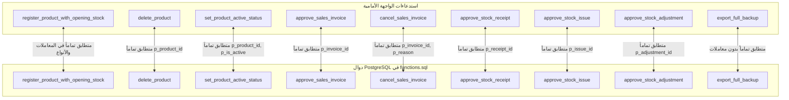

# تقرير التوافق الشامل بين الواجهة وقاعدة البيانات
# Al-Amira Database Compatibility & RPC Signature Report

> **تاريخ التقرير:** 16 نوفمبر 2026  
> **محرك قاعدة البيانات المعتمد:** PostgreSQL 15/16 (Supabase Cloud)  
> **محرك الفحص المعزول:** PGlite 0.5.16 (PostgreSQL 16)

---

## 1. خريطة مطابقة الجداول (Table Mapping Matrix)

يوضح الجدول التالي كافة الجداول المعرفة في مخطط قاعدة البيانات (`supabase/schema.sql`) مقارنة بالجداول المستعلم عنها داخل كود الواجهة الأمامية (`index.html`):

| اسم الجدول في المخطط (Schema Table) | مستخدم في الواجهة؟ | اسم الجدول في استعلامات الواجهة | حالة التوافقية | ملاحظات التدقيق |
| :--- | :---: | :--- | :---: | :--- |
| `public.authorized_users` | نعم | `authorized_users` | ✅ متطابق | استعلام `select('is_active')` للتحقق من الجلسة |
| `public.categories` | نعم | `categories` | ✅ متطابق | استعلام القائمة وإضافة التصنيفات |
| `public.products` | نعم | `products` | ✅ متطابق | الإدراج والتحديث وجلب بيانات الأصناف |
| `public.customers` | نعم | `customers` | ✅ متطابق | الإضافة والتعديل والحذف والاستعلام |
| `public.suppliers` | نعم | `suppliers` | ✅ متطابق | الإضافة والتعديل والحذف والاستعلام |
| `public.stock_receipts` | نعم | `stock_receipts` | ✅ متطابق | استعلام وإدراج أذون الاستلام |
| `public.stock_receipt_items` | نعم | `stock_receipt_items` | ✅ متطابق | إدراج بنود الاستلام التابعة |
| `public.stock_issues` | نعم | `stock_issues` | ✅ متطابق | استعلام وإدراج أذون الصرف |
| `public.stock_issue_items` | نعم | `stock_issue_items` | ✅ متطابق | إدراج بنود الصرف التابعة |
| `public.sales_invoices` | نعم | `sales_invoices` | ✅ متطابق | استعلام وإدراج وتحديث الفواتير |
| `public.sales_invoice_items` | نعم | `sales_invoice_items` | ✅ متطابق | إدراج وحذف بنود الفواتير في التعديل |
| `public.inventory_adjustments` | نعم | `inventory_adjustments` | ✅ متطابق | استعلام وإدراج تسويات الجرد |
| `public.inventory_adjustment_items`| نعم | `inventory_adjustment_items` | ✅ متطابق | إدراج بنود التسوية مع الفروقات |
| `public.inventory_movements` | نعم | `inventory_movements` | ✅ متطابق | قراءة سجل الحركات المعصوم (Read-Only) |
| `public.backup_metadata` | نعم | `backup_metadata` | ✅ متطابق | قراءة وتسجيل بيانات النسخ الاحتياطي |
| `public.application_settings` | نعم | `application_settings` | ✅ **متطابق (تم الإصلاح)** | تم تصحيح استعلامات الواجهة لتستهدف `application_settings` بالكامل |

---

## 2. التحقيق في مسميات أعمدة تسويات الجرد (Inventory Adjustment Columns)

بناءً على التكليف المباشر في التدقيق بمقارنة مسميات:
* `system_stock` مقابل `recorded_quantity`
* `physical_stock` مقابل `actual_quantity`
* `difference` مقابل `difference_quantity`

### النتيجة المؤكدة بالأدلة القاطعة:
في كافة ملفات مخطط قاعدة البيانات (`schema.sql` سطر 280، و `combined_setup.sql` سطر 280، ودوال الاعتماد في `functions.sql` سطر 515)، وفي كود الواجهة الأمامية (`index.html` سطر 4950)، **المسميات الرسمية الوحيدة المعتمدة والمنفذة برمجياً هي:**
1. **`recorded_quantity`**: تمثل الرصيد الدفتري المسجل في النظام قبل بدء الجرد (NUMERIC(14, 3) NOT NULL).
2. **`actual_quantity`**: تمثل كمية الجرد الفعلي المحصورة بالمخزن (NUMERIC(14, 3) NOT NULL CHECK (actual_quantity >= 0)).
3. **`difference`**: تمثل مقدار الفارق الناتج عن طرح الدفتري من الفعلي (`actual_quantity - recorded_quantity`).

> [!NOTE]
> لا يوجد أي عمود باسم `system_stock` أو `physical_stock` في جداول قاعدة البيانات إطلاقاً. هذه المسميات كانت مجرد مصطلحات نقاشية في بعض التقارير ولم تدخل المخطط الرسمي. استخدام الواجهة الحالية لأعمدة `recorded_quantity` و `actual_quantity` و `difference` صحيح ومتوافق تماماً مع مخطط SQL.

---

## 3. مطابقة توقيعات الإجراءات المخزونة (RPC Function Signatures)

تم حصر كافة دوال RPC المستدعاة في `index.html` ومطابقتها حرفياً مع المعرف في ملفات `supabase/functions.sql`:

### التفاصيل التفصيلية للمعاملات والأنواع:

1. **`register_product_with_opening_stock`**:
   - **الواجهة:** ترسل `{ p_sku, p_name, p_unit, p_opening_quantity, p_allows_decimal_quantity, p_category_id, p_purchase_price, p_selling_price, p_min_stock_level, p_description }`.
   - **قاعدة البيانات:** تقبل نفس المعاملات بنفس الأسماء والأنواع الافتراضية.
   - **حالة التوافق:** ✅ **متطابق 100%**.
   - *ملاحظة:* يوجد إجراء بديل مساعد باسم `register_opening_stock(p_product_id, p_opening_quantity, p_unit_cost, p_notes)` لتسجيل الرصيد بعد الإنشاء إذا لزم الأمر.

2. **`delete_product`**:
   - **الواجهة:** ترسل `{ p_product_id: productId }`.
   - **قاعدة البيانات:** تقبل `p_product_id UUID`.
   - **حالة التوافق:** ✅ **متطابق 100%**.

3. **`set_product_active_status`**:
   - **الواجهة:** ترسل `{ p_product_id: productId, p_is_active: newStatus }`.
   - **قاعدة البيانات:** تقبل `p_product_id UUID, p_is_active BOOLEAN`.
   - **حالة التوافق:** ✅ **متطابق 100%**.

4. **`approve_sales_invoice`**:
   - **الواجهة:** ترسل `{ p_invoice_id: invoiceId }`.
   - **قاعدة البيانات:** تقبل `p_invoice_id UUID`.
   - **حالة التوافق:** ✅ **متطابق 100%**.

5. **`cancel_sales_invoice`**:
   - **الواجهة:** ترسل `{ p_invoice_id: invoiceId, p_reason: reason }`.
   - **قاعدة البيانات:** تقبل `p_invoice_id UUID, p_reason TEXT`.
   - **حالة التوافق:** ✅ **متطابق 100%**.

6. **`approve_stock_receipt`**:
   - **الواجهة:** ترسل `{ p_receipt_id: receiptId }`.
   - **قاعدة البيانات:** تقبل `p_receipt_id UUID`.
   - **حالة التوافق:** ✅ **متطابق 100%**.

7. **`approve_stock_issue`**:
   - **الواجهة:** ترسل `{ p_issue_id: issueId }`.
   - **قاعدة البيانات:** تقبل `p_issue_id UUID`.
   - **حالة التوافق:** ✅ **متطابق 100%**.

8. **`approve_stock_adjustment`**:
   - **الواجهة:** ترسل `{ p_adjustment_id: adjId }`.
   - **قاعدة البيانات:** تقبل `p_adjustment_id UUID`.
   - **حالة التوافق:** ✅ **متطابق 100%**.

9. **`export_full_backup`**:
   - **الواجهة:** تستدعي الدالة بدون معاملات `.rpc('export_full_backup')`.
   - **قاعدة البيانات:** معرفة بدون معاملات وترجع `JSONB`.
   - **حالة التوافق:** ✅ **متطابق 100%**.

---

## 4. التحقيق في المسميات المتضاربة بالواجهة (Naming Discrepancies)

* **النزاع 1:** `register_product_with_opening_stock` مقابل `create_product_opening_balance`:
  - **الحقيقة:** اسم الدالة في PostgreSQL هو `register_product_with_opening_stock`. كود جافاسكريبت في الواجهة يستدعي `register_product_with_opening_stock`. ولكن في شاشة الإعدادات بالواجهة (`settings-panel-system`) كُتب في الجدول التوضيحي `create_product_opening_balance` بالخطأ!
* **النزاع 2:** `set_product_active_status` مقابل `archive_product`:
  - **الحقيقة:** اسم الدالة في PostgreSQL هو `set_product_active_status`. كود جافاسكريبت يستدعي `set_product_active_status`. ولكن في جدول شاشة الإعدادات كُتب `archive_product` بالخطأ!

---

## 5. ترتيب وتدرج ملفات الهجرة (Migration Dependencies & Execution Order)

في حال نشر قاعدة بيانات نظيفة وجديدة من الصفر:
1. **الخيار الموصى به:** تشغيل ملف التثبيت المجمع `supabase/combined_setup.sql` بعد تصحيح خطأ ترتيب أوامر GRANT وإضافة صلاحيات الجداول لدور `authenticated`.
2. **الخيار المتعدد (Modular Execution):**
   1. `supabase/schema.sql` (إنشاء الجداول والقيود والمحفزات).
   2. `supabase/functions.sql` (إنشاء كافة دوال RPC مع وضع أوامر GRANT بعدها).
   3. `supabase/rls.sql` (تفعيل RLS وإضافة سياسات الصفوف ومنح صلاحيات الجداول).
   4. `supabase/seed.sql` (إنشاء دالة تزويد المستخدمين وإدراج إعدادات المؤسسة الأولية).

في حال ترقية قاعدة بيانات موجودة مسبقاً (Populated Database):
1. **الخطوة 1:** تطبيق `supabase/migration_decimal_quantities.sql` (توسيع دقة الكميات إلى NUMERIC(14, 3) وإضافة عمود allows_decimal_quantity).
2. **الخطوة 2:** تطبيق `supabase/migration_product_lifecycle.sql` (إضافة دالتي delete_product و set_product_active_status).
3. **الخطوة 3:** تطبيق `supabase/migration_opening_balance.sql` (إضافة دالة register_product_with_opening_stock).
4. **الخطوة 4:** تطبيق تصحيح GRANTs الجداول لضمان عمل REST API.
